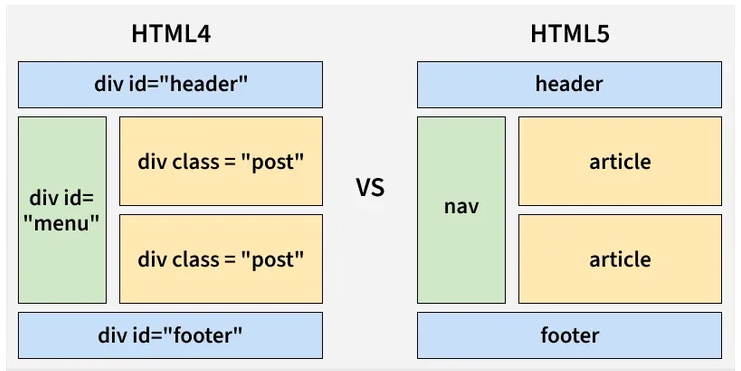

# HTML5

HTML5 is the fifth version of HyperText Markup Language, a standard language used to structure webpages. it defines how content on a webpage should be structure and displayed.



## Features of HTML5

- it included semantic elements that clearly describes their meaning in a web page's structure. semantic elements convey specific information about the content they enclose. this helps both browsers and developers understand the role of different parts of a web page,leading to better-organized and more meaningful HTML documents.
  - it can improve seo
  - enhanced accessibility
  - better code readability

  _example_

```html
<header></header>
<footer></footer>
<nav></nav>
```

- Forms and inputs types. it introduced several new input types that significantly enhance the functionality and user experience of forms.
  - email: Validates that the entered values is a valid email address
  - date: provides a date picker,allowing users to select dates easily.
  - range: creates a slider for selecting a value within a specified range.
  - number: restricts inputs to numeric values and can include additional like min,max, and step.
    _example_

  ```html
  <input type="email" /> <input type="date" /> <input type="range" />
  <input type="number" />
  ```

- Form Enhancements
  - built in validation for input field,reducing the need for custom js validation.Attributes like ==required==,==pattern==,==min==,==max== can be used to enforce input constraints.
  - placeholder Attributes it provides a hint or example of the expected input,displayed within input field until the user starts typing.
- Multimedia support
  - it has included audio and video elements making it easier to embed and control Multimedia content directly in web pages.
  - native playbacks
  - custom controls
  - captions and subtitles
  - streaming
- Geolocation API : The Geolocation API is a web technology that allows websites and web applications to access a user’s geographical location
- Offline Capabilities
  - localStorage: Stores data within no expiration time.
  - sessionStorage: Stores data for the duration of the page session.
- Canvas and SVG
  - the canvas element in HTML5 provides a versatile way to draw graphics on a web page using js.

there are many more elements in html5 than i have mentioned here

## Reference

[HTML5](https://www.geeksforgeeks.org/html/html5-introduction/)
